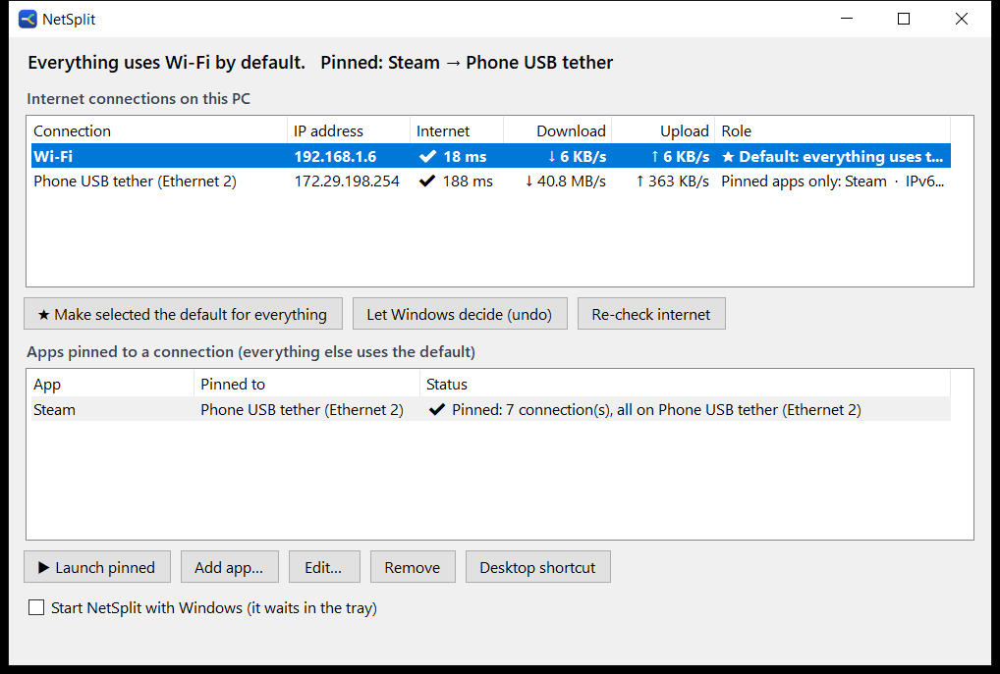

# NetSplit

Use two internet connections on one Windows PC at the same time: pin a heavy app, like Steam, to one connection and keep everything else on another.

Here's the typical setup: a phone tethered over USB for fast game downloads, and home Wi-Fi for browsing and YouTube. Normally Windows sends all traffic through one connection, so a Steam download makes everything else crawl. With NetSplit, Steam downloads over the phone and your browser keeps Wi-Fi to itself.



## What it does

- **Finds your connections.** It lists every adapter with internet access, such as Wi-Fi, Ethernet or a USB phone tether, along with live download and upload speed. It also checks whether each one can actually reach the internet.
- **Lets you choose the default.** Pick the connection everything uses unless told otherwise. NetSplit changes the Windows interface priority (metric) and can undo it with **Let Windows decide**.
- **Pins apps to a connection.** Add any `.exe`, choose a connection, and its traffic goes there while the rest of the PC stays on the default.
- **Stops IPv6 leaks.** If only the non-default connection has IPv6, YouTube and Google would keep using it. NetSplit turns IPv6 off on that adapter and turns it back on when you undo.
- **Warns you about problems.** It flags a connection that's up but has no internet, an app that's leaking onto the wrong connection, and a pinning service that isn't running.
- **Runs from the tray.** It keeps watching after you close the window, and you can set it to start with Windows.

## Install

1. Download `NetSplit.exe` from [Releases](../../releases), or [build it](#build-from-source), and put it in its own folder.
2. Run it. If Steam is installed and a phone tether is connected, a Steam rule is created for you.
3. Click **⚙ Turn on pinning service** and approve the admin prompt. You only do this once, and the service then starts every time you log in.
4. Select the connection for everyday use, usually Wi-Fi, and click **★ Make selected the default for everything**.

You need Windows 10 or 11 with .NET Framework 4.x, which ships with Windows.

## How it works

Windows routes all traffic by interface metric. The adapter with the lowest metric wins, and the others sit idle.

**Default connection.** NetSplit sets the chosen adapter's metric to 10 and the others to 50 and up, using `Set-NetIPInterface`.

**Pinned apps.** A small elevated background service (`NetSplit.exe --agent`, registered as the scheduled task *NetSplit Agent*) checks the TCP connections of the pinned apps every half second:

1. For each public server a pinned app talks to, it adds a host route (`x.x.x.x/32`) through the pinned connection's gateway.
2. Connections that already went out the wrong way are reset, so the app reconnects through the new route.
3. Routes expire 15 minutes after the app stops using them. They are never saved permanently and disappear on reboot.

This works at the routing level, so it doesn't matter how the app opens its connections. It also covers apps that restart themselves, like Steam after an update. The service logs what it routes to `agent.log` next to the exe.

**Optional: ForceBindIP.** If you run `tools\get-forcebindip.ps1`, NetSplit uses [ForceBindIP](https://r1ch.net/projects/forcebindip) when it launches a pinned app. That binds the app's connections to the right network from the very first connection, before the service has seen them. You don't need it: Steam's download connections slip past ForceBindIP anyway, which is why the service exists.

### Limits

- Pinning is per server, not strictly per app. If another app talks to the same server as a pinned app while that server's route is active, its traffic follows the route too. For Steam's download servers this rarely matters.
- Only IPv4 is routed. Keep IPv6 off on the pinned connection, which **Make default** does for you when needed.
- A single download can't use both connections at once. For that, see [Plexo](https://github.com/anmolkapil/plexo).

## Build from source

```bat
src\build.cmd
```

This compiles `NetSplit.exe` into the repo root with the C# compiler that comes with Windows (`%WINDIR%\Microsoft.NET\Framework64\v4.0.30319\csc.exe`). You don't need Visual Studio or the .NET SDK. Everything is in a single source file, `src/NetSplit.cs`.

## Files next to the exe

| File | What it is |
|---|---|
| `netsplit.json` | Your apps and settings |
| `agent.log` | What the pinning service routed |
| `agent-routes.txt` | Routes currently added, cleaned up if the service crashes |
| `tools\` | Optional ForceBindIP |

## Uninstall

1. Click **Let Windows decide (undo)**.
2. In an admin PowerShell, run `Unregister-ScheduledTask 'NetSplit Agent' -Confirm:$false`.
3. Untick **Start NetSplit with Windows**.
4. Delete the folder.

## Credits

- The idea came from [Plexo](https://github.com/anmolkapil/plexo) by Anmol Kapil, a download manager that splits one download across several networks by binding each connection to a network's address.
- [ForceBindIP](https://r1ch.net/projects/forcebindip) by Richard Stanway (optional).

## License

[MIT](LICENSE)
